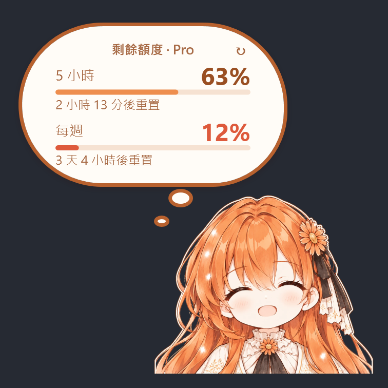

# Claude 娘額度挂件

> **非官方社群專案**，與 Anthropic 無任何隸屬或合作關係。「Claude」、「Claude Code」是 Anthropic 的商標。程式碼以 MIT 授權發佈，角色圖為作者以 AI 生成的原創角色；詳見 [NOTICE.md](NOTICE.md) 與 [LICENSE](LICENSE)。

<p>
  
  
</p>

坐在 Claude 桌面版視窗右下角的角色挂件。點她就會顯示 Claude Code 訂閱的 **5 小時**與**每週**剩餘額度，也就是 `/usage` 看到的那兩個數字。功能參考 GPT 娘（Codex 版），程式碼為獨立重寫的 C#／WPF，不需要 Node.js。

## 操作

| 動作 | 結果 |
| --- | --- |
| 點角色 | 打開額度泡泡：剩餘百分比、進度條，前 2 秒顯示「多久後重置」，後 3 秒顯示重置的日期時間，然後自動收起 |
| 再點角色 | 額度多顯示一會兒；如果正在顯示語錄，就切回額度 |
| 點泡泡 | 額度 → 語錄 → 收起 |
| 泡泡裡的 ↻ | 立即重新整理額度 |
| 拖曳角色 | 移動位置（移動超過 3 px 才算拖曳）；位置會記住 |
| 右鍵或 ☰ 按鈕 | 設定選單：顯示在 Claude 視窗上／整個桌面、桌面置頂、大小（0.6–2.5 倍）、音效與音量、編輯語錄、開機自動啟動、先隱藏、結束 |

- 跟著 Claude 視窗移動；Claude 最小化或關閉時會隱藏，被其他視窗蓋住時也會一起被蓋住。點她不會搶走 Claude 輸入框的焦點。
- 放在視窗左半邊時她會轉向內側，文字保持正向。
- 額度每分鐘更新一次，只在她顯示時更新。懸停在額度上可看到已用百分比、完整重置時間與更新時間。

## 安裝

雙擊 **`Install.cmd`**。它會建置到 `%LOCALAPPDATA%\Programs\ClaudeNiang`、登記開機自動啟動、在開始功能表加上「Claude Niang」捷徑，並立即啟動。

解除安裝：執行安裝資料夾裡的 `Uninstall.cmd`。

`Check-Usage.cmd` 會查詢一次額度並印出數字，用來排除問題。

## 額度資料從哪來

讀取本機 Claude Code 的登入資料（`%USERPROFILE%\.claude\.credentials.json`），向 Anthropic 查詢訂閱用量。登入資料只會送到 Anthropic，不會記錄或顯示。

登入過期時，她會用 Claude Code 同樣的方式更新登入，並寫回同一個檔案，讓 Claude Code 繼續可用。如果顯示「登入已過期」，在終端機執行一次 `claude` 就會更新。以 API Key 登入的帳號沒有訂閱額度資料。

## 自訂

- 語錄：右鍵 →「編輯語錄…」，存檔後選「重新載入語錄」。`weight` 越大越常出現。
- 設定存在安裝資料夾的 `state\settings.json`。

## 開發

```powershell
powershell -NoProfile -ExecutionPolicy Bypass -File .\scripts\build.ps1
.\build\ClaudeNiang.exe --render <輸出資料夾>   # 不開視窗，把各種狀態畫成 PNG
```

`tools\Cutout.cs` 是把角色從原圖背景摳出、加上貼紙白邊的工具：

```powershell
.\build\Cutout.exe assets\character-source.png assets\claude-niang.png 1000
```
